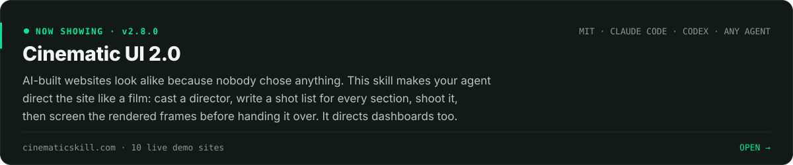
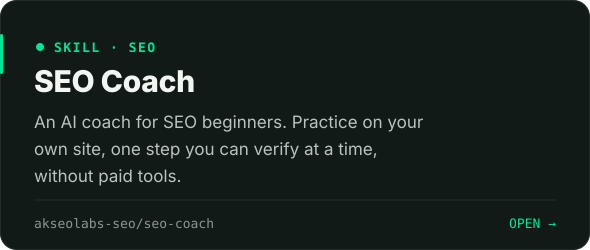
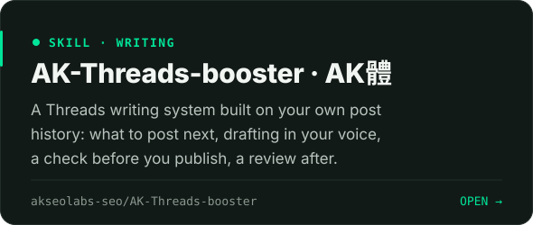
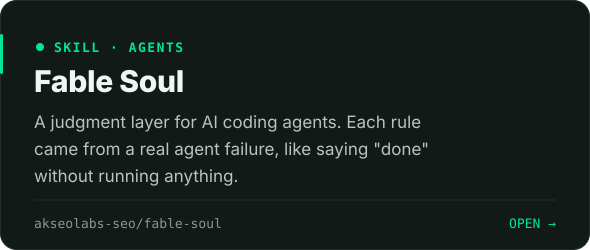
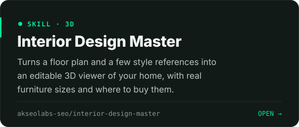

 

I'm AK. I run [AK SEO Labs](https://akseolabs.com) in Taiwan and write about SEO on Threads.
I treat search like any other code: it has rules, patterns and edges, so I test before I believe.

When a method keeps working, I turn it into a skill for AI agents and open-source it.
They run in Claude Code, Codex and most other agents. To install one, paste the repo link to your agent and ask it to set it up.

 

<a href="https://cinematicskill.com/gallery/">Live demos</a> · <a href="https://cinematicskill.com/docs/">Docs</a> · <a href="https://github.com/akseolabs-seo/cinematic-ui/releases/download/v2.8.0/cinematic-ui-2.0-launch.mp4">Launch film</a> · <a href="https://github.com/akseolabs-seo/cinematic-ui">Repo</a>

 

Earlier experiments

 

- [LingYun](https://github.com/akseolabs-seo/LingYun-Vibe-Coding-Style-Generator): drop in a screenshot of a design you like, get a style prompt you can hand to a coding AI.
- [Anti-Low-End-SEO-Planner](https://github.com/akseolabs-seo/Anti-Low-End-SEO-Planner): a basic content planner for low-competition niches.

 

Threads is where I post most, in Traditional Chinese. For SEO work, start at akseolabs.com.

 

